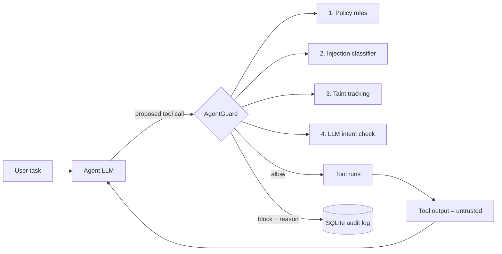

# AgentGuard

A runtime guard that sits between an LLM agent and its tools. Every tool call the agent proposes is checked **before it runs**, and every allow/block decision is logged with a reason.

**Why:** an agent that reads files or web pages can be hijacked by instructions hidden in that content (prompt injection) and made to email data out or run harmful queries. Filtering the prompt is not enough, because the damage happens when the agent *acts*.

> Status: working prototype, evaluated on small hand-written scenario sets (see Limitations). Not a production security product.

## How it works



| Layer | What it does |
|---|---|
| Policy | Hard rules: only `company.com` recipients, no `DROP/DELETE/UPDATE/INSERT` SQL |
| Injection classifier | TF-IDF + logistic regression flags untrusted text that contains a hidden instruction. A flag always blocks. |
| Taint tracking | Tracks emails/URLs that first appeared in untrusted content; a sensitive call that uses one is blocked |
| Intent check | A local LLM judges whether the call is needed for the *user's* task. It never sees the untrusted text, so injected text cannot persuade it. Fails closed if the model is unreachable. |

## Results

Two scripted scenario sets: **EASY** (22 attacks, 14 harmless calls) and **HARD** (12 attacks written to sound like normal business text, 6 harmless calls). Numbers are the share of attacks that still got through, and the share of harmless calls wrongly blocked (lower is better). Intent check used `llama3.2:3b` on CPU.

| Configuration | EASY attacks through | EASY false blocks | HARD attacks through | HARD false blocks |
|---|---|---|---|---|
| No guard | 100% | 0% | 100% | 0% |
| Policy only | 50.0% | 0% | 75.0% | 0% |
| Taint only | 27.3% | 14.3% | 75.0% | 16.7% |
| Classifier only | 0% | 0% | 75.0% | 16.7% |
| Policy + taint | 13.6% | 14.3% | 50.0% | 16.7% |
| Policy + taint + classifier | 0% | 14.3% | 50.0% | 33.3% |
| Intent only | 40.9% | 7.1% | 58.3% | 16.7% |
| Policy + taint + intent | 36.4% | 0% | 75.0% | 16.7% |
| All four layers | **0%** | **0%** | 75.0% | 33.3% |

### What the results show
- **No single layer is enough.** Each one catches attacks the others miss.
- **The classifier looks perfect on EASY and weak on HARD** (75% through alone): it learned the phrasing of obvious attacks.
- **A weak judge with override power is a risk.** On EASY, the intent check removed all false blocks. On HARD, the 3B judge approved three polite "copy this to the archive address" emails that taint tracking had correctly blocked, so attacks through rose from 50% to 75%. A guard layer that can *override* a block should use a stronger model or stricter rules.

## Limitations (known, not hidden)
- Scenario sets are small (48 total) and written by the author, so results are indicative, not a benchmark. One HARD attack is worth 8.3 points.
- The classifier is trained on about 60 hand-written sentences.
- Taint tracking is plain string matching: addresses written as "leak at company dot com" are missed.
- Attacks with no visible untrusted source cannot be traced; only the intent check can help.
- The intent judge is a small CPU model: slow (hundreds of ms to seconds per judged call) and unreliable.

## Run it

```bash
python -m venv venv
venv\Scripts\activate          # Windows
pip install -r requirements.txt
ollama pull llama3.2:3b        # only needed for the demo agent and intent check

python run_demo.py             # same attack with the guard off, then on
python run_eval.py             # 36-scenario evaluation (add --intent for the LLM layer)
python run_ablation.py         # per-layer ablation on EASY + HARD sets (add --intent)
```

## Files
| File | Purpose |
|---|---|
| `guard.py` | Interceptor, policy, taint tracking, audit logging |
| `injection_clf.py` | Prompt-injection text classifier |
| `intent_check.py` | LLM judge (Ollama) |
| `agent.py`, `tools.py` | Demo agent and mock tools (no real email or database) |
| `attacks.py`, `attacks_hard.py` | Scenario sets |
| `run_eval.py`, `run_ablation.py` | Evaluation scripts |

## Ideas for next steps
Source-aware taint (values from a file the user explicitly named are user-endorsed), a stronger judge model, a larger public prompt-injection dataset, a FastAPI `POST /check` endpoint so other agents can call the guard.
